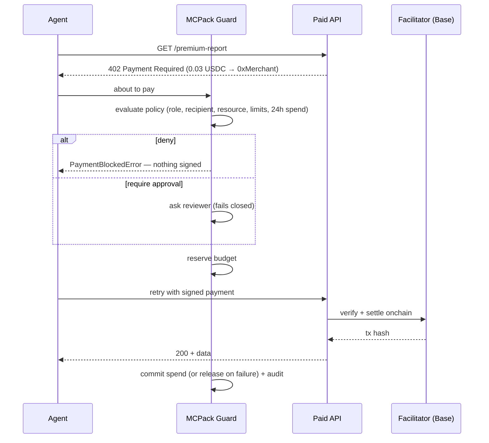

# MCPack x402 Guard

**Spend controls for AI agents that pay onchain.**
Per-role payment limits, rolling daily budgets, recipient allowlists, resource scoping and human approval for [x402](https://www.x402.org/) payments on Base — enforced *before* the agent signs anything.

Part of [MCPack](#relation-to-mcpack), a policy layer for agentic tool stacks. MCPack already decides which tools an agent may *call*; this module extends the same allow / deny / require-approval model to what an agent may *pay*.

```
1. Small purchase within limits          ✅ 0.01 USDC settled
2. Above approval threshold              ⏸️ reviewer approved → settled
3. Over per-payment limit                ⛔ OVER_PER_PAYMENT_LIMIT
4. Recipient not on allowlist            ⛔ PAYTO_NOT_ALLOWED
5. Keep buying until budget runs out     ✅ ✅ ✅ ✅ ✅ ✅ ⛔ OVER_DAILY_BUDGET
6. Agent outside its resource scope      ⛔ RESOURCE_NOT_ALLOWED
7. Agent with no payment policy          ⛔ UNKNOWN_ROLE (default deny)
```

---

## The problem

x402 lets an agent pay for an API call with USDC in a single HTTP round trip: the server answers `402 Payment Required`, the agent signs a transfer authorization, the facilitator settles it on Base. That's what makes agentic commerce work — and it also means **an agent holding a funded wallet can spend money with no human in the loop**.

The x402 v2 client ships basic spend controls: a per-payment USD cap (default $1) and an allowlist of tokens. That stops one obviously large payment. It does not answer the questions an operator running a fleet of agents actually has:

| Operator question | x402 built-in | This guard |
|---|---|---|
| Can a single payment be too big? | ✅ per-payment cap | ✅ per **role** |
| How much can this agent spend **today**? | ❌ stateless | ✅ rolling 24h budget |
| **Who** is it allowed to pay? | ❌ | ✅ recipient allowlist |
| **What** is it allowed to buy? | ❌ | ✅ resource URL scoping |
| Can a human sign off on bigger purchases? | ❌ | ✅ approval threshold, fails closed |
| Do different agents get different limits? | ❌ one config per client | ✅ role-based policies |
| What did it spend, and why was something blocked? | ❌ | ✅ redacted audit log |

## How it works



The guard plugs into the official `@x402/fetch` client through its `onBeforePaymentCreation` and `onPaymentResponse` hooks, so it works with any x402 server without changes on the server side.

### Policy

```json
"research-agent": {
  "maxPerPayment": "0.05",
  "dailyBudget": "0.10",
  "approvalAbove": "0.02",
  "allowedPayTo": ["0xMerchant..."],
  "allowedResources": ["https://api.example.com/*"]
}
```

Checks run in a fixed order and the first failure wins, so every block has exactly one clear reason:

`role exists → scheme → asset & network → resource → recipient → per-payment limit → daily budget → approval threshold`

Hard limits are checked before approval, so a reviewer is never asked to approve something that would be blocked anyway.

### Design decisions

- **Default deny.** An agent role without a policy cannot pay. A missing reviewer means "no".
- **Block before signing.** A denied payment never produces a signature, so there is nothing to leak or replay.
- **Reserve → commit / release.** Budget is reserved when a payment is approved and only committed when the facilitator confirms settlement. If the API rejects the payment or settlement fails, the reservation is released — a flaky endpoint can't burn an agent's budget.
- **Re-check after approval.** Budgets are re-evaluated after a human approves, because other payments may have landed while they were deciding.
- **Redacted audit trail.** Who, whom, how much, for what, and why — but never signatures or payment payloads.
- **Validate policy on load.** A policy where `approvalAbove > maxPerPayment` (approval can never trigger) or `maxPerPayment > dailyBudget` is rejected at startup, not discovered in production.

## Quick start (local, no wallet needed)

```bash
npm install
npm run demo      # APPROVE=yes npm run demo to skip the approval prompt
npm test          # 24 tests: policy engine + end-to-end with real x402 middleware
```

Local mode runs the real x402 client and Express middleware, signs genuine EIP-3009 USDC authorizations with a throwaway key, and verifies the signatures in a local facilitator. Only settlement is simulated.

## Run it on Base Sepolia (real USDC, ~10 minutes)

1. **Create a throwaway agent wallet**
   ```bash
   npx tsx scripts/new-wallet.ts
   ```
   Never reuse a wallet that holds real funds.
2. **Fund it with testnet USDC** — go to the [Circle faucet](https://faucet.circle.com/), pick *Base Sepolia*, paste the agent address. No ETH is needed: x402 payments are gasless for the payer (the facilitator submits the transaction).
3. **Configure** — `cp .env.example .env`, then fill in `AGENT_PRIVATE_KEY`, a `MERCHANT_ADDRESS` you control, and any second address as `UNLISTED_ADDRESS`.
4. **Start the paid API** (terminal 1)
   ```bash
   MODE=testnet npm run server
   ```
5. **Run the agents** (terminal 2)
   ```bash
   MODE=testnet npm run demo
   ```
   Allowed payments print a `sepolia.basescan.org` link to the real transaction. The full run spends 0.10 USDC.

## Relation to MCPack

MCPack is a drop-in policy gateway for MCP-based agent stacks: role-scoped tool visibility, allow / deny / require-approval rules, and audit logging. This module applies the same model to money:

| MCPack tool policy | x402 payment policy |
|---|---|
| Which tools a role can see and call | Which resources a role can pay for |
| Tool argument constraints | Amount, recipient, asset, network constraints |
| Require approval for sensitive tools | Require approval above a spend threshold |
| Redacted tool-call audit log | Redacted payment audit log |

## Limitations and roadmap

- **Ledger is in memory.** Budgets reset when the process restarts and aren't shared across processes. Next: a pluggable ledger backed by Redis or Postgres.
- **Budgets are per role**, not per individual agent or per user. Next: hierarchical budgets (org → role → agent).
- **Only the `exact` scheme** is allowed. `upto` (pay up to a maximum) needs budget accounting on the settled amount rather than the authorized one.
- **Approvals are synchronous** (terminal prompt). Next: async approvals via Slack or a web queue with a timeout.
- **Offchain enforcement only.** The guard protects agents that run through it; a leaked key bypasses it. Pairing it with onchain spend limits (e.g. smart-account spend permissions on Base) would give defense in depth.
- **Coinbase AgentKit integration** — expose the guarded fetch as an AgentKit action so any AgentKit agent gets these controls by default.

## Project layout

```
src/policy/engine.ts      deterministic policy evaluator
src/policy/ledger.ts      reserve / commit / release spend ledger
src/guard.ts              x402 client hooks → guarded fetch for agents
src/audit.ts              redacted audit sinks (console, JSONL)
src/demo/server.ts        demo paid API (x402 Express middleware)
src/demo/agent.ts         seven-scenario agent demo
src/demo/local-facilitator.ts  offline facilitator that verifies real signatures
test/                     unit + end-to-end tests
```

## License

MIT
